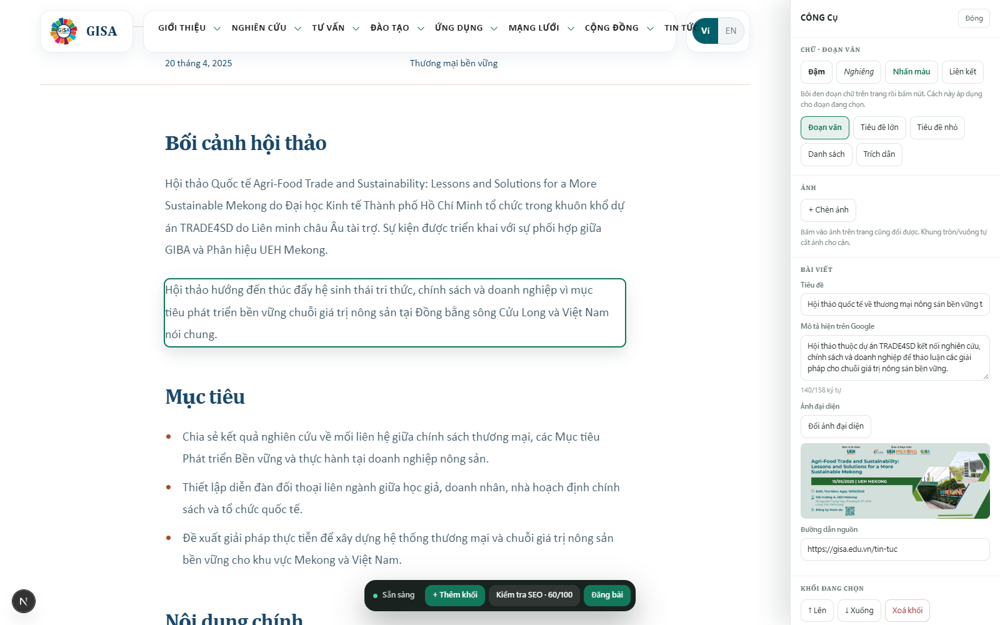
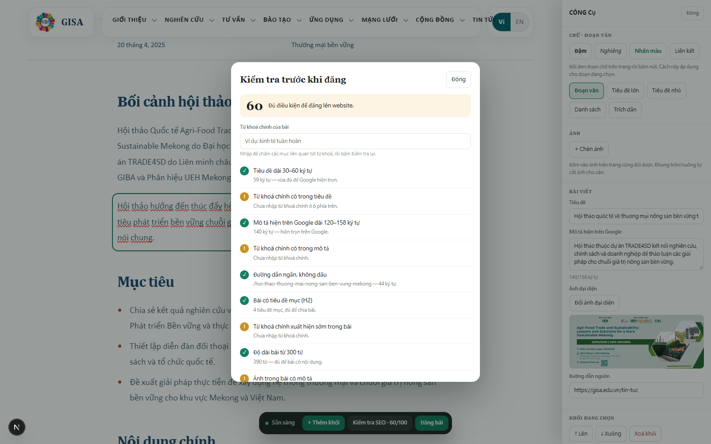
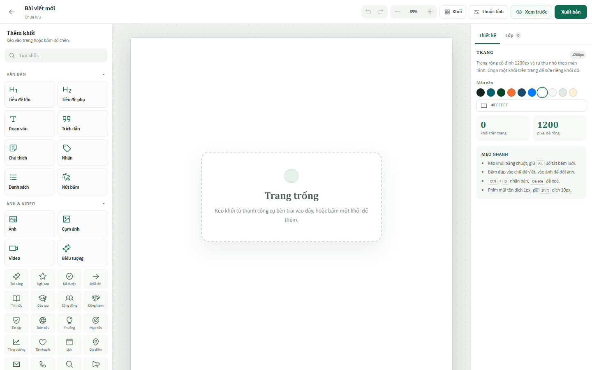
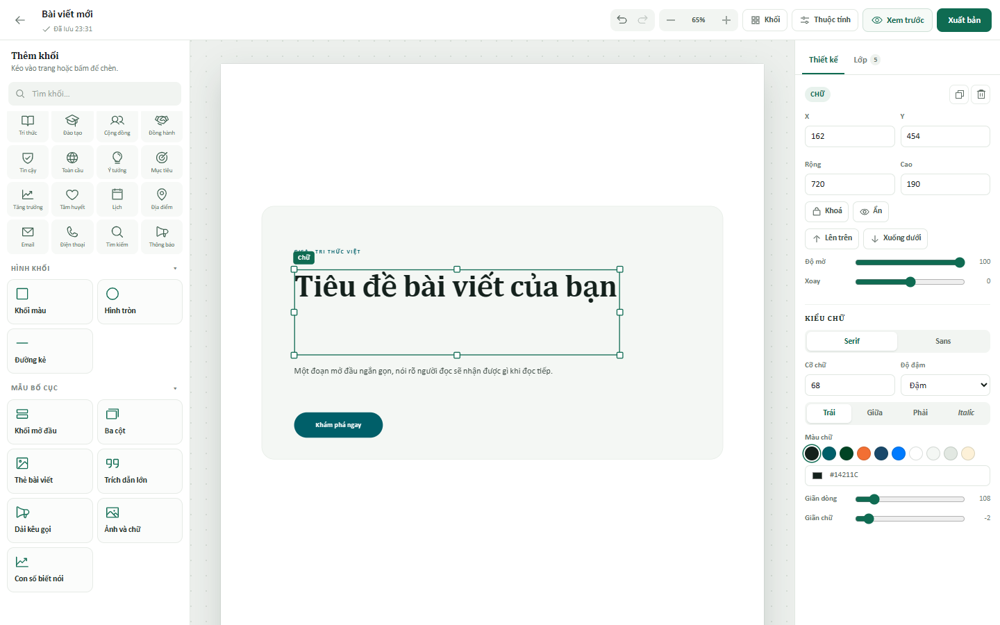
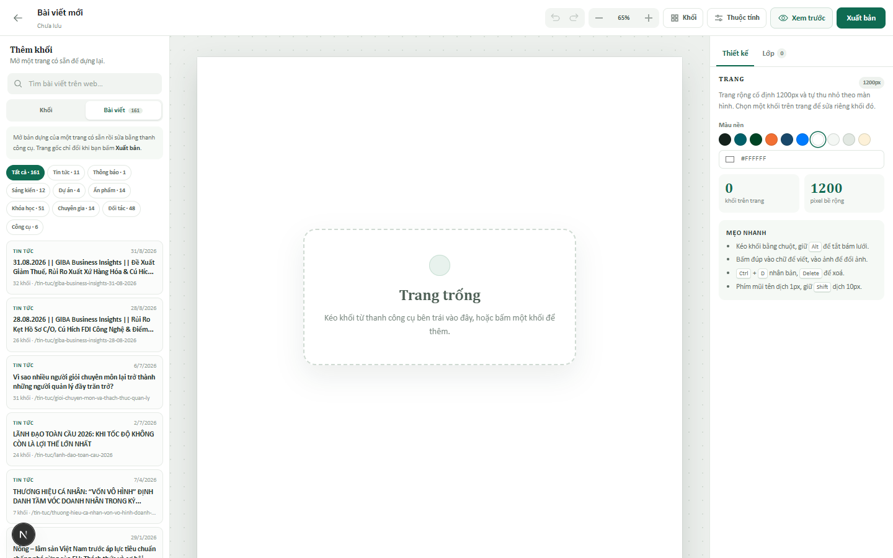
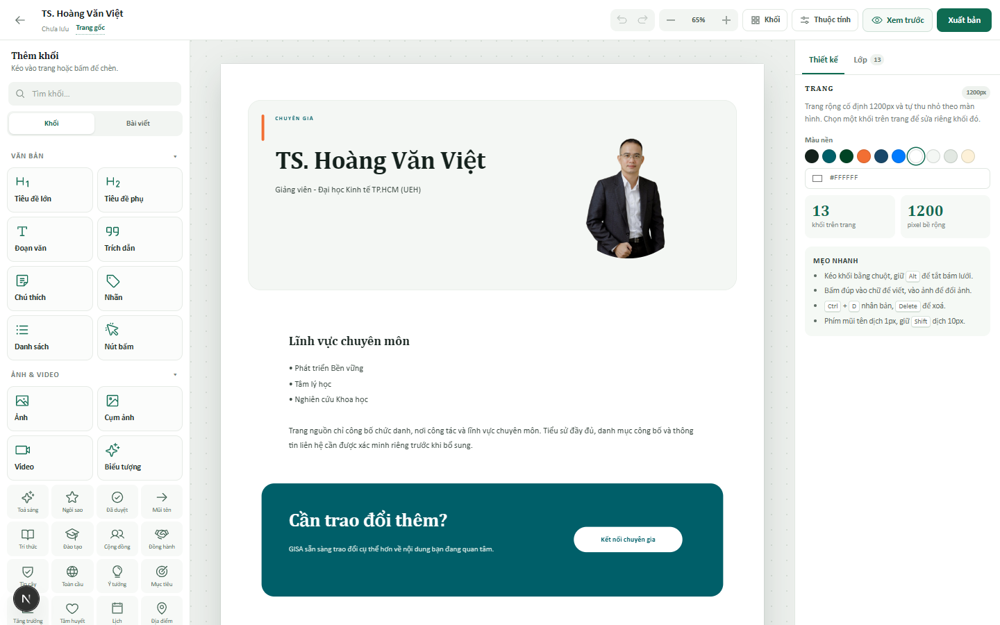
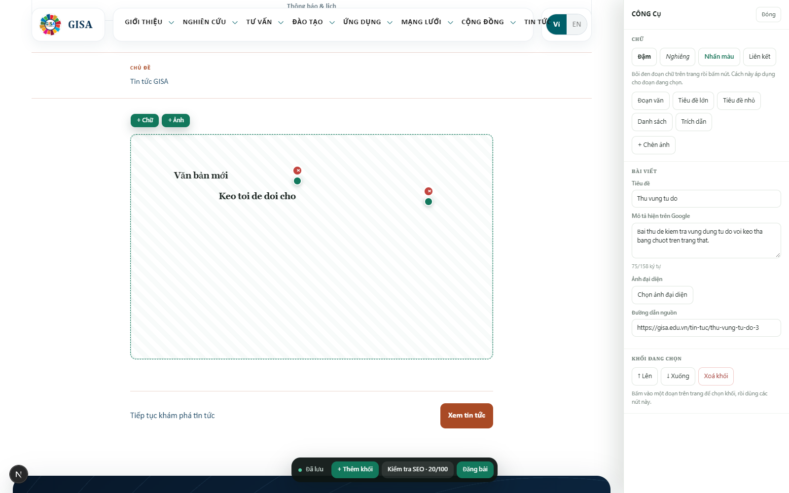

# Soạn bài ngay trên trang thật (bản chạy thử)

> **Cập nhật 30/10/2026:** phần đầu tài liệu này mô tả editor cũ (`/xem-truoc`). Studio
> hiện tại nằm ở `/admin/studio` và đã có thêm nhiều thay đổi so với bản trước — xem mục
> **Studio** bên dưới. Báo cáo kiểm tra chi tiết: [studio-audit.md](studio-audit.md).

Một màn hình duy nhất: mở đúng bài trên website, bấm vào chữ để viết, kéo đủ thứ trong
hộp công cụ bên phải, bấm **Kiểm tra SEO** để biết cần sửa gì, rồi **Đăng bài**.





## Chạy

```powershell
pnpm dev --port 3006
```

Vào bằng một trong hai cách:

1. Đi trên website như khách → mỗi bài đang quản lý có nút **“Sửa bài này”** ở góc phải
   dưới → mở thẳng trang đó ở chế độ soạn.
2. Mở <http://localhost:3006/admin> để xem danh sách, hoặc tạo bài mới rồi bấm vào bài.

`.env.local` đặt `NEWS_SOURCE=admin` và `NEXT_PUBLIC_ADMIN_LOCAL=1` cho bản chạy thử.

> `/admin` và `/xem-truoc` tự trả 404 khi `NODE_ENV=production`, trừ khi đặt
> `ADMIN_LOCAL=1`. Bản deploy thật không mở hai route này.

## Quy trình làm một bài

1. **Tạo**: `/admin` → `+ Tạo bài mới` mở **studio** — một trang trắng rộng 1200px,
   chỉ có thanh trên cùng. Hoặc mở một bài có sẵn để sửa trực tiếp trên trang thật.
2. **Dựng trang trong studio**: kéo khối từ thanh công cụ bên trái vào trang, kéo khối
   để dời, kéo tay nắm để đổi kích thước, bấm đúp để viết. Xem mục *Studio* bên dưới.
3. **Bài có sẵn**: bấm vào tiêu đề hoặc đoạn văn trên trang, gõ trực tiếp.
   - `Enter` tạo đoạn mới.
   - Bôi đen chữ rồi bấm **Đậm / Nghiêng / Nhấn màu / Liên kết** ở hộp bên phải.
   - `+ Thêm khối` để chèn đoạn văn, tiêu đề mục, danh sách, trích dẫn, ảnh.
4. **Ảnh**: bấm vào ảnh trên trang để đổi ảnh và chọn khung Ngang / Vuông / Tròn.
5. **Kiểm tra SEO**: bấm `Kiểm tra SEO` trên thanh dưới → hộp thoại chấm điểm /100 và
   liệt kê từng mục cần sửa bằng tiếng Việt.
6. **Đăng**: bấm `Đăng bài`. Còn mục `×` thì nút Đăng bị khoá trong hộp thoại SEO.

Mọi thay đổi tự lưu sau khoảng 0,6 giây (editor cũ); studio tự lưu sau khoảng 0,9 giây và
cập nhật chữ đang gõ ngay. Không có nút Lưu bắt buộc.

## Studio — dựng trang tự do (1200px)

`/admin` → `+ Tạo bài mới` (hoặc `/admin/studio`). Trang bắt đầu trống hoàn toàn: chỉ có
thanh trên cùng với tên bài, trạng thái lưu, hoàn tác, thu phóng, **Xem trước** và
**Xuất bản**. Không có bố cục mẫu nào bị khoá sẵn.





- **Trang rộng cố định 1200px**, thu nhỏ bằng `transform: scale()` cho vừa màn hình. Toạ độ
  lưu bằng pixel nên trang đã đăng giống hệt lúc dựng, không lệch theo màn hình người đọc.
- **Thanh công cụ bên trái**: 22 khối (tiêu đề, đoạn văn, trích dẫn, nhãn, nút, ảnh, cụm
  ảnh, video, biểu tượng, khối màu, hình tròn, đường kẻ) và 7 mẫu bố cục dựng sẵn (khối mở
  đầu, ba cột, thẻ bài viết, trích dẫn lớn, dải kêu gọi, ảnh và chữ, con số biết nói) cùng
  20 biểu tượng. Có ô tìm khối.
- **Kéo từ thanh công cụ vào đúng vị trí** (có bóng xem trước), hoặc bấm một khối để chèn
  vào giữa vùng đang xem.
- **Kéo khối bằng chuột** để dời; bám lưới 8px, bám cạnh/tâm khối khác và trục giữa trang,
  hiện đường gióng hồng. Giữ `Alt` để tắt bám.
- **8 tay nắm** để đổi kích thước; bấm đúp vào chữ để viết; bấm đúp vào ảnh để tải ảnh lên.
  Khối đã xoay vẫn kéo được tay nắm theo đúng trục của khối.
- **Bảng bên phải**: toạ độ, kích thước, độ mờ, xoay, khoá/ẩn, thứ tự lớp; kiểu chữ, màu,
  bo góc, khung ảnh, liên kết nút, liên kết video. Tab **Lớp** để chọn khối bị che.
  Toạ độ/kích thước được chặn trong trang; khối khoá không sửa/xoá/kéo được cho tới khi mở khoá.
  Nút **Vừa chiều cao với nội dung** tự đo lại khối chữ.
- **Phím tắt**: `Ctrl+Z` / `Ctrl+Shift+Z` hoàn tác–làm lại, `Ctrl+D` nhân bản, `Delete` xoá,
  phím mũi tên dịch 1px (`Shift` = 10px), `Esc` bỏ chọn, `Ctrl+S` lưu ngay (kể cả khi đang gõ).
- **Tự lưu** sau ~0,9 giây vào `content-data/admin/studio/<id>.json`. Chữ đang gõ được cập nhật
  ngay vào bản nháp; đóng tab/back/reload sẽ gửi nốt bản mới nhất. Bài mới được tạo bản nháp ở
  lần sửa đầu tiên.
- **Xuất bản**: trang bắt đầu từ một bài có sẵn sẽ hỏi xác nhận rồi đăng lên đường dẫn gốc
  (`/tin-tuc/...`, `/khoa-hoc/...`); trang trắng không gắn bài nào thì nằm ở `/xem-bai/<id>`.
  Không cho xuất bản trang không có khối nào. Nút **Bỏ đăng** hỏi lại và trả trang gốc về giao diện cũ.
- **Nhiều bản cùng một đường dẫn**: bản bấm Xuất bản gần nhất sẽ thắng; danh sách `/admin` ghi
  **Đang hiển thị** cho bản đang thật sự đứng sau đường dẫn, các bản còn lại ghi **Bị thay thế**.
- **Màn hình hẹp**: hai bảng trượt thành ngăn kéo, thanh dưới cùng có **Khối / Thuộc tính / Xem**;
  thanh trên vẫn giữ tên bài + trạng thái lưu, có nút zoom nổi. Xem trước có nút chuyển
  **Máy tính / Điện thoại**.
- **Trang đã đăng trên điện thoại**: dưới 960px, trang tự chuyển sang bố cục dọc (chữ 16–36px,
  ảnh full chiều rộng, các dải hero/CTA giữ nền) thay vì thu nhỏ cả khung 1200px.
- Khi xem site ở local, nếu trang đã có bản dựng studio thì nút nổi đổi thành **Sửa bản dựng**
  và mở thẳng studio; trang chưa có bản dựng mới mở editor cũ.

Cùng một renderer dùng cho lúc dựng, hộp xem trước và trang đã đăng, nên ba nơi không thể
lệch bố cục.

### Thư viện bài viết trên web



Tab **Bài viết** trong thanh công cụ liệt kê toàn bộ trang đang có trên website — 161 trang ở
9 loại: tin tức, thông báo, sáng kiến, dự án, ấn phẩm, khóa học, chuyên gia, đối tác, công cụ.
Có ô tìm và chip lọc theo loại.

- Bấm một trang → studio dựng lại trang đó thành các khối tự do: nhãn loại, tiêu đề, tóm tắt,
  ảnh bìa, toàn bộ đoạn văn / tiêu đề mục / danh sách / trích dẫn / ảnh / bảng / liên kết, và
  dải kêu gọi ở cuối. Mọi khối sửa được bằng đúng thanh công cụ ở trên.
- Trang đã có bản dựng được gắn badge **Đang sửa** hoặc **Đã đăng bản dựng**; bấm vào sẽ mở
  đúng bản dựng đó thay vì tạo thêm một bản trùng.
- Bản dựng nhớ `sourcePath`. **Xuất bản** hỏi xác nhận rồi làm đường dẫn gốc hiển thị bản dựng;
  **Bỏ đăng** trả lại giao diện cũ. Nội dung gốc trong kho không bị sửa.
- Trang `/xem-bai/<id>` vẫn dùng cho các trang trắng không gắn với bài nào; nếu bản dựng có
  `sourcePath`, trang này được `noindex` và canonical về đường dẫn gốc.



Giới hạn: chỉ đường dẫn đã có trong `PAGE_REGISTRY` mới nhận bản dựng; trang chủ, trang danh
sách và trang chính sách chưa có mô hình nội dung để dựng lại. Nếu có nhiều bản đã đăng cho
cùng một đường dẫn, bản mới nhất thắng.

## Định dạng chữ được hỗ trợ

| Nút | Kết quả | Cách lưu |
|---|---|---|
| Đậm | **chữ đậm** | `**chữ đậm**` |
| Nghiêng | *chữ nghiêng* | `*chữ nghiêng*` |
| Nhấn màu | chữ màu xanh GISA | `==chữ nhấn==` |
| Liên kết | chữ thành link | `[chữ](https://…)` |

Lưu dưới dạng văn bản có dấu hiệu, không lưu HTML — nên không có đường chèn script, và
website dựng lại bằng React. Không có chỉnh màu tự do, font hay cỡ chữ: đó là chỗ dễ phá
thương hiệu và bố cục nhất, nên cố ý chỉ cho một màu nhấn.

## Đang quản lý loại nội dung nào

| Loại | Số bản nạp sẵn | Đường dẫn |
|---|---|---|
| Tin tức | 11 | `/tin-tuc/…` |
| Thông báo | 1 | `/tin-tuc/thong-bao-lich/…` |
| Sáng kiến | 12 | `/cong-dong/…` |

Thêm loại mới = thêm vào `EDITORIAL_KINDS` trong `src/lib/admin/store.ts` và bật nhánh
template tương ứng; phần soạn, đăng, hoàn tác không phải sửa.

## Dữ liệu nằm ở đâu

```
content-data/admin/
├── drafts/       bản đang sửa
├── published/    bản đã đăng (website đọc thư mục này)
├── history/      20 bản lưu gần nhất cho mỗi bài
└── studio/       bài dựng tự do trong studio, mỗi bài một file JSON
public/media/uploads/   ảnh tải lên
```

- Lần đầu mở, kho được nạp từ nội dung đang có trên site.
- Xoá `content-data/admin/` là trở về trạng thái ban đầu.
- Bài đang nháp bị ẩn khỏi website công khai (URL trả 404) cho tới khi đăng.
- Bài studio đã xuất bản xem tại `/xem-bai/<id>`; bản nháp trả 404.

## Sửa trang chủ và trang tĩnh

Bài viết lưu trong `ContentRecord`; còn trang tĩnh là bố cục, chữ nằm rải trong
component. Cơ chế cho chúng:

- `src/lib/admin/pages.ts` giữ phần chữ đã sửa, theo từng đường dẫn và từng khoá.
- `<PageText k="home.news.title" text="…" />` bọc một đoạn chữ. Ở `?edit=1` nó thành ô
  sửa được; bấm ra ngoài là lưu; ngoài chế độ sửa chỉ là chữ thường.
- Trên trang chủ có nút **“Sửa trang chủ”** ở góc phải dưới.

Hiện đã bọc 3 tiêu đề mục lớn của trang chủ (`home.news.title`, `home.intro.title`,
`home.mission.title`). Banner đầu trang là carousel nhiều slide nên chưa đưa vào — mỗi
slide cần một khoá riêng. Muốn thêm chữ nào thì bọc đoạn đó bằng `<PageText>` với một
khoá mới; không phải sửa gì khác.

## Vùng tự do (kéo thả bằng chuột)



`+ Thêm khối` → **Vùng tự do**. Trong vùng đó:

- `+ Chữ` thêm một đoạn chữ, `+ Ảnh` tải ảnh từ máy vào vị trí bất kỳ
- **Kéo** khối để dời, **kéo chấm xanh ở góc** để phóng to / thu nhỏ
- **Nháy đúp** vào chữ để sửa nội dung, `×` đỏ để xoá
- Mọi thứ lưu theo phần trăm, nên khi khung hẹp lại (điện thoại) cả vùng co theo
  và không tràn ra ngoài

Đây là vùng dựng tự do bên trong một bài viết dạng cột, không phải đặt chữ lên bất kỳ
đâu của cả trang. Lý do: bài viết chảy theo cột; nếu cho đặt tự do lên toàn trang thì mỗi
lần đổi cỡ màn hình bố cục sẽ vỡ. Muốn dựng cả trang tự do thì dùng **Studio** — ở đó
trang rộng cố định 1200px rồi thu nhỏ, nên bố cục không đổi giữa các màn hình.

## Chưa có (cố ý, để làm tiếp)

- **Trang chủ và trang tĩnh**: nội dung đang nằm trong component, cần mô hình
  "trang = danh sách section dựng sẵn" trước khi cho sửa.
- Các loại chi tiết khác (dự án, ấn phẩm, khóa học, chuyên gia) dùng template riêng.
- Bấm vào ảnh bìa trên trang để đổi (hiện đổi trong hộp công cụ).
- Duyệt nhiều bước, phân quyền, hẹn giờ đăng, link xem trước có hạn.
- Redirect tự động khi đổi đường dẫn.
- Bài mới chưa có slug/đường dẫn thật: đang nằm ở `/xem-bai/<id>`, chưa lên danh sách/sitemap.
- Studio: chọn/nhóm nhiều khối cùng lúc, khoá tỉ lệ khi kéo góc, lịch sử phiên bản,
  cộng tác nhiều người, và mẫu bố cục đọc từ kho ngoài thay vì viết trong mã.

## Kiểm tra kỹ thuật

```powershell
node node_modules\typescript\bin\tsc --noEmit --incremental false
node node_modules\eslint\bin\eslint.js src/components/studio src/app/admin src/app/xem-bai src/app/api/admin/studio
node node_modules\vitest\vitest.mjs run src/components/studio/geometry.test.ts
```
