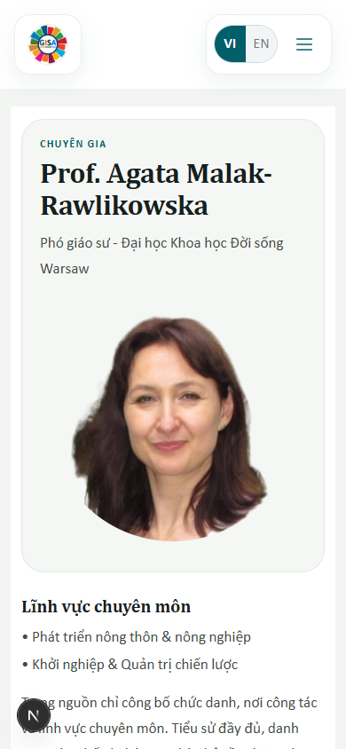
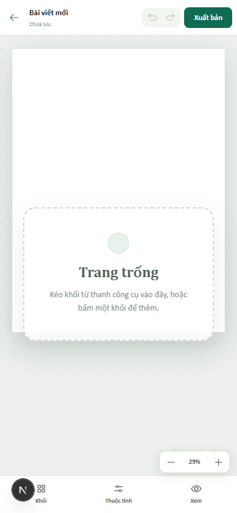
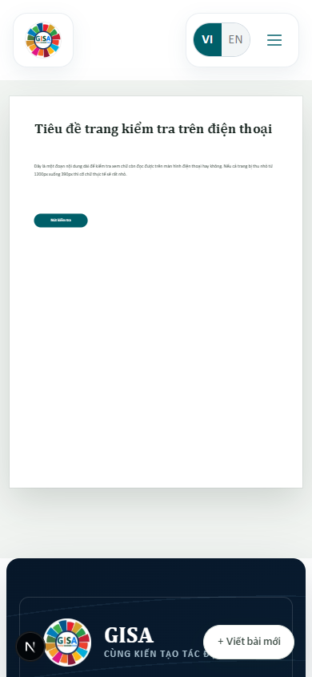
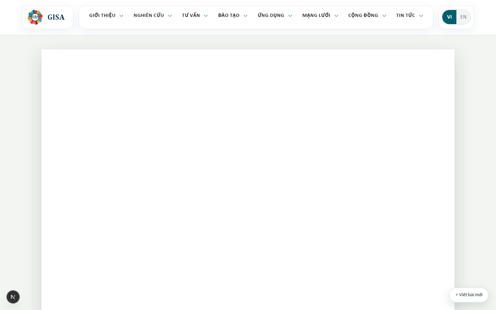
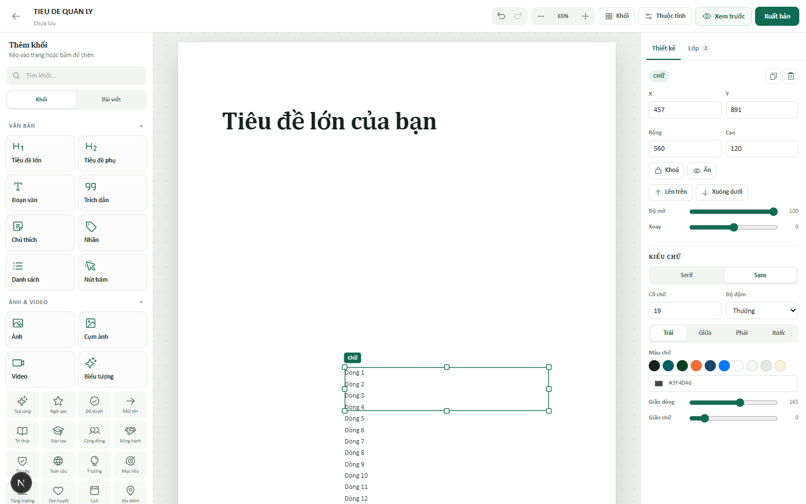
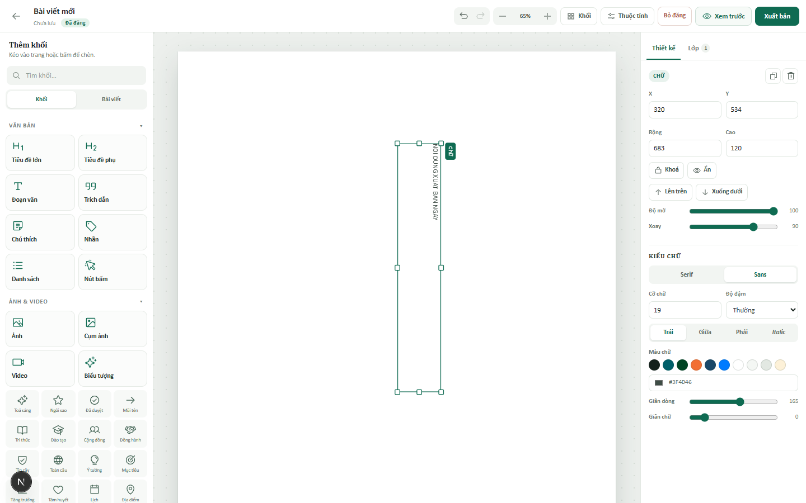
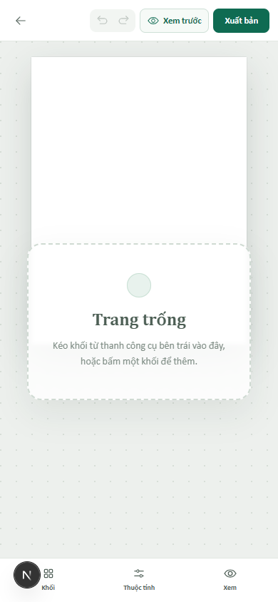

# Kiểm tra toàn bộ studio admin

> **Cập nhật 30/10/2026:** báo cáo này ghi lại tình trạng **trước khi sửa**. Các nhóm đã được
> xử lý ngay sau đó: tự lưu chữ đang gõ + flush khi rời trang, publish đúng bản mới nhất,
> trùng ID template, khoá toàn bộ khối, clamp toạ độ, resize khối xoay, tự giãn chiều cao chữ,
> chiều cao trang tĩnh, reflow mobile + preview điện thoại, header/zoom mobile, badge template,
> xoá draft + trạng thái “Đang hiển thị”, H1/alt/canonical, chặn đăng trang trống, xác nhận
> đè/bỏ đăng, ghi file tuần tự khi autosave/publish trùng nhau, và nút **Sửa bản dựng** trên
> site mở thẳng studio. Các mục còn lại (slug cho bài mới, focus trap, auto-scroll, multi-select,
> layer kéo thả, định dạng trong dòng, crop ảnh) vẫn nằm trong kế hoạch.

Ngày kiểm tra: 30/10/2026 · Môi trường: dev `http://127.0.0.1:3006`, Chrome thật qua Playwright.
Phạm vi: `/admin`, `/admin/studio`, `/admin/studio/[id]`, API studio, trang đã đăng ở đường dẫn gốc và `/xem-bai/[id]`.
Đã thao tác thật: kéo–thả, sửa chữ, khoá, xoay, đổi kích thước, hoàn tác, xuất bản, bỏ đăng, back/reload, 9 template đại diện, 4 bề rộng màn hình.

> Toàn bộ bản nháp dùng để test đã được xoá. Chỉ còn bản nháp `studio-mvtuc9r9-ljc8.json` của bạn, không bị sửa.

## 1. Kết luận ngắn

Nền tảng đã dùng được: kéo–thả ổn, snap tốt, undo/redo có, 161 template mở được, xuất bản đè trang gốc và bỏ đăng hoạt động, không có lỗi console ở luồng bình thường.

Nhưng **chưa nên dùng thật** cho tới khi sửa 4 việc:

1. **Trang đã đăng trên điện thoại không đọc được**: toàn trang 1200px bị thu còn 30%, chữ 19px còn **5,8px**.
2. **Chữ đang gõ chưa được tự lưu**: chỉ lưu khi bấm ra ngoài. Rời trang khi đang gõ là mất chữ, không có cảnh báo.
3. **Xuất bản có thể báo thành công nhưng trang không đổi**: khi có 2 bản cùng đè một đường dẫn, bản cũ bấm “Xuất bản” lại không thắng.
4. **Một template bị trùng ID khối sau khi lưu** (trang đối tác Zagreb): 12 khối còn 9 ID, React báo lỗi key trùng, sửa/xoá có thể tác động nhầm khối.

Ngoài ra có một nhóm vấn đề P1 làm admin khó dùng: khoá vẫn xoá/sửa được, chữ tràn khối, trang ngắn bị kéo cao 1600px, tiêu đề trên thanh trên không hiện trên trang, mobile admin mất tên bài và nút zoom, trang mới chỉ nằm ở `/xem-bai/<id>`.

## 2. Bảng ưu tiên

| # | Mức | Vấn đề | Bằng chứng | Hướng sửa |
|---|---|---|---|---|
| 1 | **P0** | Trang public trên mobile bị thu nhỏ toàn bộ, chữ không đọc được | 390px: scale 0.305, body 19px → 5,8px | Reflow dọc cho mobile, hoặc tối thiểu cho phép cuộn ngang; thêm preview mobile |
| 2 | **P0** | Chữ đang gõ trong contentEditable không vào state/autosave | Gõ rồi Back: mở lại vẫn là chữ cũ | `onInput` cập nhật state có debounce; flush khi ẩn trang/unmount; đánh dấu dirty |
| 3 | **P0** | Xuất bản lại không trở thành bản đang hiển thị | A publish trước, B publish sau; sửa A, bấm Xuất bản, trang vẫn là B | Mỗi lần publish phải set `publishedAt = now`; hoặc chỉ cho 1 bản live/đường dẫn |
| 4 | **P0** | Trùng ID khối do cắt ID 80 ký tự | Template Zagreb: 12 khối → 9 ID; 6 lỗi React key | Bỏ cắt ID / dùng ID ngắn; chống trùng khi sanitize |
| 5 | P1 | Có thể xuất bản trang trống, chỉ có tiêu đề quản lý | Trang 1600px trắng, tab trình duyệt có tiêu đề, không có H1 | Chặn publish nếu 0 khối; cảnh báo trước khi đăng; làm rõ tiêu đề |
| 6 | P1 | Xuất bản đè trang thật chỉ bằng 1 cú bấm; sửa sau khi đăng là live ngay | Không có xác nhận; status vẫn `published` nên autosave cập nhật trang | Xác nhận đường dẫn; tách “Lưu nháp” / “Cập nhật trang”; nói rõ đang live |
| 7 | P1 | Chữ dài tràn khối, đè nội dung bên dưới | Khối 120px, 12 dòng: scrollHeight 376px | Tự tăng chiều cao, hoặc cảnh báo tràn + nút “vừa nội dung” |
| 8 | P1 | “Khoá” không khoá thật | Khoá rồi Delete vẫn xoá; double-click vẫn sửa chữ | Khoá toàn bộ sửa/xoá/kéo; hoặc đổi tên thành “Khoá vị trí” |
| 9 | P1 | Nhập X/Y ra ngoài trang, không chặn | X=5000, Y=-40 được chấp nhận; khối biến mất/ bị cắt | Clamp theo 1200px và mép trên; thêm nút căn giữa/đưa vào trang |
| 10 | P1 | Kéo tay nắm của khối đã xoay sai hướng | Xoay 90°, kéo phải 80px: rộng 720 → 683px | Đổi delta theo góc xoay, hoặc ẩn tay nắm khi đã xoay |
| 11 | P1 | Chiều cao trang tối thiểu 1600px tạo khoảng trắng lớn | Bản nháp của bạn kết thúc ở 716px → 884px trắng | Chiều cao static = nội dung + lề; cho chỉnh chiều cao trang |
| 12 | P1 | Tiêu đề trên thanh trên chỉ là metadata, không hiện trên trang | Đổi tiêu đề, trang không đổi; publish chỉ tiêu đề → trang trắng | Đổi nhãn “Tên bài (không hiện trên trang)” hoặc render H1; thêm khối tiêu đề mặc định |
| 13 | P1 | Bài mới chỉ có `/xem-bai/<id>`, không vào danh sách/sitemap/menu, không có slug | Sitemap chỉ có PAGE_REGISTRY + record; không có `/xem-bai` | Thêm slug/kind/đường dích và tạo record khi đăng; hoặc chỉ rõ đây là bản xem thử |
| 14 | P1 | Mobile admin mất tên bài, trạng thái lưu, link trang gốc; không có zoom | ≤820px `docMeta` bị ẩn; ≤1100px zoom bị ẩn; canvas 25% | Header gọn có tên + trạng thái; zoom/pinch; fit đúng padding |
| 15 | P1 | Danh sách admin không xoá/sửa tên/nhân bản draft; không biết bản nào đang live | 0 nút xoá; mọi bản published đều ghi “Đã đăng” | Thêm menu draft, badge “Đang hiển thị”, xác nhận xoá |
| 16 | P1 | Thư viện template không báo trang đã có bản dựng/đang đè | Bấm lại cùng một trang tạo draft thứ 2 | Badge “Đang sửa/Đã đăng”; nút “Mở bản đang sửa” |
| 17 | P1 | SEO/ngữ nghĩa trang đã đăng yếu | Không có H1, mọi chữ là `div`, mất structured data, ảnh không có alt | Map role → h1/h2/p/blockquote; thêm alt, structured data, canonical |
| 18 | P1 | Lỗi lưu chỉ hiện chữ nhỏ, không retry; không có nút Lưu | `Lỗi lưu` 11px, không banner | Banner + thử lại; nút Lưu; Ctrl+S cả khi đang gõ |
| 19 | P2 | Không tự cuộn khi kéo khối / kéo từ palette đến vùng ngoài màn hình | Trang 1600–3000px | Auto-scroll khi gần mép |
| 20 | P2 | Chưa chọn nhiều khối, căn hàng, nhóm, phân bố | — | Shift-click/marquee, align/distribute |
| 21 | P2 | Layer chưa kéo đổi thứ tự, chưa tìm, chưa đổi tên | — | Kéo trong tab Lớp |
| 22 | P2 | Chưa có định dạng trong dòng (đậm/nghiêng/link) | — | Rich text hoặc ít nhất gạch đầu dòng/nhấn mạnh |
| 23 | P2 | Ảnh chưa kéo-thả từ máy, chưa sửa alt, chưa crop | — | Drop ảnh, alt, crop |
| 24 | P2 | Focus bàn phím chui ra sau studio; preview không trap focus | Tab đầu tiên vào “Bỏ qua đến nội dung chính” của site | `inert` site chrome; focus trap cho preview/drawer |
| 25 | P2 | Tài liệu mô tả UI cũ (SEO, Đăng bài, 0,6 giây) và hai editor cùng tồn tại | `docs/admin-local.md` dòng 1–42 | Cập nhật docs; thống nhất entry point |

## 3. Chi tiết 4 lỗi P0

### P0-1. Trang đã đăng không đọc được trên điện thoại

`StaticPage` lấy `scale = min(width / 1200, 1)` rồi scale toàn bộ trang (`src/components/studio/static-page.tsx:24`). Vì mọi thứ là pixel tuyệt đối, chữ cũng bị scale theo.

Đo thực tế ở 390×844:

- khung trang 366px, scale **0.305**
- body 19px → **5,795px**
- heading 56px → **17,08px**
- ảnh chụp: `docs/admin-preview/audit-public-mobile.png`

Đây là hệ quả trực tiếp của lựa chọn “1200px rồi scale”, nhưng với trang công khai thì không chấp nhận được: người đọc điện thoại phải phóng to, chữ 5,8px dưới ngưỡng đọc tối thiểu.

**Hướng sửa đề xuất**

- Ưu tiên: ở breakpoint ≤ 768px, render một phiên bản **reflow dọc** theo thứ tự khối (sort theo `y`, rồi `x`), bỏ toạ độ tuyệt đối, cho chữ chạy theo cột. Có thể giữ đúng màu/nội dung, chỉ đổi cách xếp.
- Hoặc cho admin chọn “bản mobile” riêng (một canvas 390px) — đúng Canva hơn nhưng tốn công dựng.
- Phương án tối thiểu: đặt `min-scale` (ví dụ 0.55) và cho cuộn ngang; chữ ~10px vẫn nhỏ, không nên coi là giải pháp.
- Thêm nút **Xem trên điện thoại** trong preview để admin thấy trước khi đăng.

### P0-2. Chữ đang gõ chưa được lưu

`ElementView` chỉ gọi `onTextCommit` trong `onBlur` (`src/components/studio/element-view.tsx:82-85`). Trong lúc gõ, DOM của contentEditable đổi nhưng `doc` React không đổi, nên:

- autosave không chạy,
- trạng thái vẫn có thể là “Đã lưu”,
- `beforeunload` không được bật (vì `saveState` không phải dirty),
- rời trang/reload/mất điện là mất toàn bộ chữ vừa gõ.

Đã tái hiện: mở trang trống, thêm đoạn văn, double-click, gõ “NOI DUNG CHUA KIP LUU”, bấm Back ngay; mở lại bản nháp vẫn là câu mặc định.

**Hướng sửa**

- Gắn `onInput` (debounce ~300–500ms) để cập nhật `doc` mà **không unmount** contentEditable (giữ uncontrolled, chỉ commit text; tránh set `value` làm nhảy caret).
- Đặt `saveState = dirty` ngay khi có input để bật cảnh báo rời trang.
- Flush khi `visibilitychange`, `pagehide`, unmount; dùng `fetch(..., { keepalive: true })` hoặc `sendBeacon`.
- Vẫn giữ commit cuối khi blur/Escape.

Lưu ý: bấm “Xuất bản” ngay sau khi gõ thì blur xảy ra trước click nên dữ liệu đã được lưu — lỗi chỉ ở trường hợp rời trang không blur.

### P0-3. Xuất bản lại không thắng bản mới hơn

`updateStudioDraft` giữ `publishedAt` cũ nếu status đã là `published` (`src/lib/admin/studio-store.ts:300-304`). `findPublishedStudioPage` chọn bản có `publishedAt` lớn nhất.

Kịch bản đã chạy:

1. Tạo A cho `/tin-tuc/thong-bao-lich/...`, publish → live = A.
2. Tạo B cùng đường dẫn, publish → live = B.
3. Sửa A, bấm **Xuất bản** → toast “Đã xuất bản lên …”, status A = published.
4. Mở trang gốc → **vẫn là B**. `publishedAt` của A không đổi.

Hệ quả: admin tin là đã đăng nhưng thực tế không; danh sách admin hiện cả A và B đều “Đã đăng”; không biết bản nào đang hiển thị.

**Hướng sửa**

- Phân biệt autosave và publish: chỉ thao tác publish mới set `publishedAt = now` (API nhận cờ `publish: true` hoặc endpoint riêng).
- Hoặc mô hình đúng hơn: mỗi `sourcePath` chỉ có tối đa một bản published; publish bản mới tự bỏ đăng bản cũ.
- Trả về cho UI biết bản nào đang live; hiện badge “Đang hiển thị”.
- Cảnh báo khi mở template đã có bản khác đang đè.

### P0-4. Trùng ID khối ở template có ID dài

`page-templates.ts` tạo ID khối bằng `${record.id}--${suffix}-${n}` (`src/lib/admin/page-templates.ts:302`). Server cắt mọi ID còn 80 ký tự (`src/lib/admin/studio-store.ts:60`).

Trang đối tác Zagreb có record.id dài 73 ký tự. 12 khối có ID 83–88 ký tự; sau khi cắt còn:

- 2 đoạn văn cùng ID `...--parag`
- 3 khối CTA cùng ID `...--cta-b`

Tức **12 khối → 9 ID**. Đã tái hiện: mở template, đổi tiêu đề để lưu, reload → 6 cảnh báo React “Encountered two children with the same key”; chọn/kéo/xoá một khối có thể tác động nhầm khối khác.

Hiện chỉ 1/161 template bị, nhưng bất kỳ record ID dài nào thêm sau này cũng sẽ bị. Đây là lỗi dữ liệu, không chỉ là cảnh báo.

**Hướng sửa**

- Bỏ `slice(0, 80)` cho ID, hoặc dùng ID ngắn: `${hash(record.id)}-${n}` / `${record.id.slice(0, 40)}-${n}`.
- Sanitize phải chống trùng: nếu ID đã tồn tại thì thêm hậu tố.
- Thêm test cho template có ID dài.

## 4. Các lỗi P1 đáng chú ý

### 4.1. Có thể đăng một trang trắng

Tiêu đề trên thanh trên không được render vào trang. Một trang mới chỉ nhập tiêu đề rồi Xuất bản sẽ ra trang trắng cao 1600px; tab trình duyệt có tiêu đề nhưng `<main>` rỗng, không có H1.

Nên: chặn publish khi không có khối hiển thị; thêm bước xác nhận/preflight; với trang mới, tự thêm khối tiêu đề hoặc nói rõ tiêu đề chỉ là tên quản lý.

### 4.2. Chữ tràn khối

Khối chữ có chiều cao cố định, không tự giãn. Đã thử 12 dòng trong khối cao 120px: `scrollHeight = 376px`; chữ tràn xuống đè nội dung dưới, trong khi khung chọn vẫn chỉ 120px.

Nên: tự tăng `h` khi commit text / đổi font-size (đo `scrollHeight`), hoặc hiện cảnh báo “Đang tràn khối” kèm nút “Vừa nội dung”. Với template, `measureText` đang ước lượng khá tốt (9 mẫu không tràn), nhưng admin gõ thêm là tràn ngay.

### 4.3. “Khoá” không khoá thật

Đã thử: khoá một khối chữ, bấm Delete → khối bị xoá; double-click → vẫn vào chế độ sửa. Inspector vẫn cho đổi X/Y/Rộng/Cao, màu, cỡ chữ. Chỉ có kéo và tay nắm resize bị chặn.

Nên: khoá toàn bộ thao tác sửa/xoá/di chuyển, hoặc đổi tên thành “Khoá vị trí” và cho phép sửa nội dung. Hiện tại nhãn gây hiểu sai.

### 4.4. Toạ độ và kích thước không bị chặn

Nhập X = 5000 hoặc Y = -40 vào inspector được chấp nhận; khối bị cắt/không thấy, chỉ còn tab Lớp để cứu. Không có nút “đưa vào trang”/“căn giữa”.

Nên clamp: `x ∈ [0, 1200 - w]`, `y ≥ 0`, `w ≥ 24`, `h ≥ 2`; hiển thị cảnh báo khi khối ra ngoài; thêm căn giữa ngang/dọc và phân bố.

### 4.5. Kéo tay nắm của khối đã xoay sai

Xoay 90° rồi kéo tay nắm phải 80px: chiều rộng từ 720px **giảm** còn 683px, tay nắm không đi theo con trỏ. Nguyên nhân: `resizeRect` nhận delta màn hình nhưng không đổi theo góc xoay.

Nên: xoay vector delta vào hệ toạ độ của khối trước khi resize, hoặc tạm ẩn tay nắm khi `rotation !== 0` và chỉ cho nhập kích thước.

### 4.6. Trang ngắn bị kéo cao 1600px

`canvasHeight` luôn trả về tối thiểu 1600px + 240px đệm (`src/components/studio/types.ts:160-162`). Bản nháp hiện tại của bạn kết thúc ở 716px, nên khi đăng sẽ có 884px trắng. Trang chỉ có tiêu đề cao đúng 1600px.

Nên: với trang tĩnh đã đăng, chiều cao = nội dung + lề (tối thiểu ~600px); trong studio vẫn có thể giữ 1600px để có chỗ kéo, nhưng hiển thị đường “hết trang” rõ ràng và cho chỉnh chiều cao.

### 4.7. Tiêu đề trên thanh trên không phải tiêu đề trên trang

Đổi tiêu đề quản lý không đổi chữ H1 trên trang (vì H1 là một khối text riêng). Với template, tiêu đề cũ vẫn nằm trong khối; metadata/tab lại dùng tiêu đề mới → lệch nhau. Với trang mới, tiêu đề không xuất hiện ở đâu cả.

Nên: đổi nhãn thành “Tên bài (dùng trong quản lý)” và thêm ghi chú; hoặc render tiêu đề thành H1 thật ở đầu trang; hoặc tự tạo khối tiêu đề khi tạo trang.

### 4.8. Bài mới không có đường dẫn thật

Trang trắng publish ra `/xem-bai/<id>`; không có slug, không nằm trong `/tin-tuc`, không vào sitemap, không lên menu, không có trong tìm kiếm. Với mục tiêu “admin chuẩn bị đăng bài”, đây là thiếu sót lớn: bài mới chỉ là một trang tách rời.

Nên quyết định: thêm `slug` + `kind` + `publishedPath` và tạo `ContentRecord` khi đăng (để lên danh sách/sitemap), hoặc nói rõ `/xem-bai` chỉ là bản xem thử và vẫn phải nhập liệu qua hệ thống cũ.

### 4.9. Mobile admin thiếu thông tin và không zoom được

Ở 390px:

- `docMeta` bị ẩn → không thấy tên bài, “Đã lưu/Lỗi lưu”, “Đã đăng”, link “Trang gốc”.
- `.zoomGroup` bị ẩn → không có cách phóng to; canvas cố định 25%.
- fit tính `(width - 88)/1200` trong khi mobile chỉ có padding 40px → thừa ~48px, canvas nhỏ hơn cần thiết.
- Empty state vẫn ghi “kéo khối từ thanh công cụ bên trái” trong khi toolbar là ngăn kéo dưới.

Nên: header gọn có tên bài + trạng thái lưu (có thể mở rộng), zoom +/− hoặc pinch, fit theo padding thực, copy theo ngữ cảnh mobile. Cân nhắc chặn hẳn việc dựng trang trên điện thoại và hiện “Nên dùng máy tính” thay vì canvas 25%.

### 4.10. Danh sách admin thiếu quản lý bản nháp

`/admin` chỉ liệt kê draft, không có xoá/đổi tên/nhân bản; ngày hiển thị không có giờ; mọi bản published đều ghi “Đã đăng” dù chỉ một bản live. Không có badge cho bản đang đè trang gốc.

Nên: menu “…” cho từng draft (Mở, Nhân bản, Đổi tên, Xoá), hiện giờ cập nhật, badge “Đang hiển thị trên /…”, lọc Nháp/Đã đăng. Xoá phải xác nhận; nếu đang published thì cảnh báo trang gốc sẽ quay về giao diện cũ.

### 4.11. Thư viện chưa cho biết trang nào đã có bản dựng

Mở cùng một trang lần thứ hai tạo draft mới, trong khi draft cũ vẫn còn (có thể đang đè trang gốc). Không có badge, không có nút “Mở bản đang sửa”. Đây là nguồn gốc của lỗi P0-3.

Nên: khi tải danh sách, join với studio drafts theo `sourcePath`; hiện “Đang sửa”, “Đã đăng”, hoặc “Có 2 bản” và cho mở bản đang có.

### 4.12. SEO và ngữ nghĩa của trang đã đăng

- Mọi text đều render bằng `div` (`element-view.tsx`), không có `h1/h2/p/blockquote`.
- Không có `StructuredData` cho trang override (trang gốc detail có).
- Ảnh không có alt khi admin tự upload; inspector không có ô alt.
- `/xem-bai/<id>` vẫn truy cập được với bản published có `sourcePath` → URL trùng nội dung, không canonical/noindex.
- Trang chỉ có tiêu đề không có H1.

Nên: map `role` sang thẻ ngữ nghĩa, thêm heading level, alt, structured data, canonical; noindex `/xem-bai` khi đã có `sourcePath`.

### 4.13. Lỗi lưu và xung đột

- “Lỗi lưu” chỉ là chữ đỏ 11px, không có nút thử lại; autosave không tự thử lại.
- Không có nút Lưu; `Ctrl+S` chỉ hoạt động khi không focus vào input (trong input sẽ mở hộp thoại Save của trình duyệt).
- Hai tab cùng sửa một draft: ghi đè lẫn nhau, không cảnh báo.
- “Bỏ đăng” không xác nhận, và có thể đua với autosave đang bay.

Nên: banner lỗi + retry backoff, nút Lưu, xử lý `Ctrl+S` toàn cục, revision/`If-Match` để phát hiện xung đột, xác nhận trước khi bỏ đăng.

## 5. Những gì đang tốt (giữ lại)

- **161 template** ở 9 loại tải đúng; mở được; 9 mẫu đại diện không tràn chữ, không ảnh hỏng.
- Kéo từ palette có ghost + preview; thả đúng vị trí; snap lưới/cạnh/tâm; Alt tắt snap.
- Undo/redo, nhân bản, phím mũi tên, `Delete`, `Esc`, `Ctrl+D` hoạt động.
- Autosave sau blur tạo draft, đổi URL bằng `replaceState`, không tạo 2 draft.
- Xuất bản/bỏ đăng đúng luồng cơ bản; xoá draft published trả trang gốc về giao diện cũ.
- Preview dùng đúng renderer với trang đăng.
- Ngăn kéo mobile mở/đóng được; vuốt trong palette vẫn cuộn, không chèn nhầm.
- Server validate, ghi file atomic, chặn ID/path lạ; API 404 khi tắt admin.
- Không có lỗi console ở luồng thao tác bình thường.

## 6. Cải thiện để admin dễ dùng hơn (không phải bug)

1. **Luồng đăng rõ ràng**: `Lưu nháp` → `Xem trước` (desktop/mobile) → `Đăng` (xác nhận đường dẫn) → `Cập nhật` / `Bỏ đăng`. Hiện “Xuất bản” vừa là publish vừa là mở tab, trạng thái live không rõ.
2. **Preflight trước khi đăng**: trang trống, khối tràn, ảnh thiếu alt, chữ quá nhỏ trên mobile, link hỏng, tiêu đề trùng. Hiện theo kiểu Canva “publish checklist” sẽ rất hợp.
3. **Chọn nhiều + căn hàng**: shift-click, marquee, align left/center/right, phân bố đều, nhóm. Đây là thiếu sót lớn nhất so với Canva.
4. **Tự cuộn khi kéo**: trang 1600–3000px, hiện không thể thả xuống vùng ngoài màn hình mà không cuộn trước.
5. **Layer panel mạnh hơn**: kéo đổi thứ tự, tìm theo chữ, đổi tên, badge ẩn/khoá, chọn nhiều.
6. **Ảnh**: kéo-thả file vào canvas, alt, crop/zoom, thay ảnh nhanh, fallback ảnh hỏng.
7. **Chữ**: auto-height, cảnh báo tràn, định dạng trong dòng (đậm/nghiêng/link), giữ caret đúng chỗ click.
8. **Template**: thumbnail, badge đã sửa/đã đăng, lọc theo “có bản dựng”, nút mở bản đang sửa; tách ô tìm của tab Khối và tab Bài viết.
9. **Quản lý draft**: xoá/đổi tên/nhân bản, thời gian cập nhật, trạng thái live, lọc, sắp xếp.
10. **Phím tắt**: bảng trợ giúp `?`, thêm `Ctrl+A` chọn tất cả, `Ctrl+G` nhóm, `[`/`]` đổi lớp.
11. **Hiệu năng**: mỗi pointermove đang set state cả doc; với 40–400 khối sẽ giật. Dùng transform tạm khi kéo, commit khi thả.
12. **Tài liệu**: `docs/admin-local.md` phần đầu vẫn mô tả editor cũ (SEO, Đăng bài, 0,6 giây), không khớp studio hiện tại; hai editor `/xem-truoc` và studio cùng tồn tại nhưng không nói khi nào dùng cái nào.

## 7. Thứ tự đề xuất

**Đợt 1 — an toàn dữ liệu (nên làm trước khi cho dùng thật)**

- Sửa ID template (P0-4).
- Flush chữ đang gõ + dirty + beforeunload (P0-2).
- Publish set `publishedAt` mới / một bản live mỗi path + badge (P0-3).
- Chặn publish trang trống; xác nhận đè trang gốc và bỏ đăng (P1-5, P1-6).
- Khoá thật; clamp X/Y/W/H; sửa resize khối xoay (P1-8,9,10).

**Đợt 2 — chất lượng trang công khai**

- Mobile reflow (P0-1) + preview mobile.
- Auto-height/overflow chữ; chiều cao trang tối thiểu (P1-7,11).
- H1/thẻ ngữ nghĩa, alt, structured data, canonical (P1-17).
- Bài mới có slug/đường dẫn thật hoặc nói rõ `/xem-bai` chỉ là xem thử (P1-13).

**Đợt 3 — dễ dùng**

- Mobile admin header + zoom (P1-14).
- Quản lý draft, badge template (P1-15,16).
- Autosave error/retry, nút Lưu (P1-18).
- Auto-scroll, multi-select/align, layer reorder (P2).

## 8. Cần bạn quyết

1. **Trang public trên mobile**: reflow dọc (khuyến nghị) hay giữ đúng bố cục và cho cuộn ngang?
2. **Bài mới**: cấp slug + đưa vào `/tin-tuc` (và sitemap) hay chỉ dùng `/xem-bai` làm bản xem thử?
3. **Sau khi đăng**: sửa là cập nhật live ngay (hiện tại) hay phải bấm “Cập nhật trang”?
4. **Khoá**: khoá toàn bộ hay chỉ khoá vị trí/kích thước?

## 9. Phụ lục — kịch bản đã chạy

| Kịch bản | Kết quả |
|---|---|
| Mở studio trống, kéo tiêu đề + đoạn văn | 2 khối, không lỗi |
| Double-click sửa chữ rồi bấm sang khối khác | Lưu đúng (blur commit) |
| Gõ chữ rồi Back ngay | **Mất chữ** |
| Gõ chữ rồi bấm Xuất bản ngay | Lưu đúng chữ mới |
| Khoá khối, Delete | **Vẫn xoá** |
| Khoá khối, double-click | **Vẫn sửa được** |
| X=5000, Y=-40 | **Nhận, khối ra ngoài** |
| 12 dòng trong khối 120px | **Tràn 376px** |
| Xoay 90°, kéo tay nắm phải | **Sai hướng/kích thước** |
| 2 draft cùng path, publish lần lượt, sửa bản cũ, publish lại | **Trang vẫn là bản mới** |
| Template Zagreb: sửa tiêu đề, lưu, reload | **12 khối → 9 ID, 6 lỗi key** |
| Publish trang chỉ có tiêu đề | **Trang trắng 1600px, không H1** |
| 390px public | **Chữ 5,8px** |
| 390px admin | **Ẩn tên bài/trạng thái, không zoom** |
| Tab lần đầu trong studio | **Focus vào skip link của site** |
| 161 template, 9 mẫu đại diện | **Tải đủ, không tràn, không ảnh hỏng** |
| Vuốt palette trên mobile | **Cuộn được, không chèn nhầm** |
